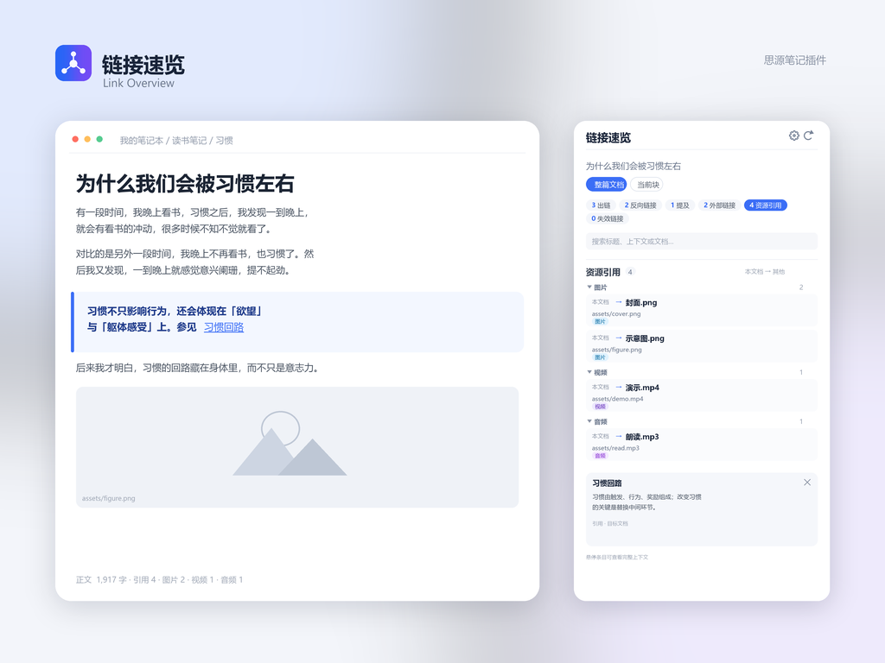

# Link Overview



A SiYuan dock plugin that collects every link around the current document — outgoing links, backlinks, mentions, external links, asset references, and dead links — into the right panel. Click any row to jump to it, without switching between the editor, the backlink panel, and the source.

## Highlights

- **Six link types in one place**: outgoing links, backlinks, mentions, external links, assets, and dead links.
- **Stats work as filters**: click “Outgoing” to show only that category, click again to show everything. The same applies to every category.
- **Assets grouped by type**: Image, Video, Audio, PDF, Document, Archive, and Other.
- **Missing assets flagged**: references to files that no longer exist are marked.
- **Isolated documents in the panel**: list documents in the current notebook that have no outgoing links, backlinks, or mentions, and open them directly.
- **Notebook health**: dead links, missing assets, and the most-linked documents for the whole notebook.
- **Copy a link report**: copy the current list as Markdown in one click.
- **Every row is clickable**: block references jump to and highlight the target, external links open in your default browser, assets open in a SiYuan tab.
- **Direction at a glance**: outgoing rows read “this document → target”; backlinks and mentions read “source → this document”.

## Usage

1. Enable **Link Overview** in Bazaar → Downloaded → Plugins.
2. Open any document and click the link icon in the right dock.
3. The panel lists the document’s six link types. Click a row to jump.

### Show one category

Click a stat chip (for example, “3 Outgoing”) to switch the panel to that category only; click the same chip again to show all categories.

Switching to another document, or switching between **Whole document** and **Current block**, resets the panel to show everything.

### Check isolated documents

When the current document has no outgoing links, no backlinks, and is not mentioned by any other document, the **Isolated documents** badge appears. Clicking it switches the panel to the orphan list in place:

- It lists documents in the current notebook with no outgoing links, backlinks, or mentions.
- Clicking a document opens it; the list stays open so you can work through several documents in a row.
- **Back to links** returns to the current document’s links.

To keep the scan responsive, only the 80 most recently updated documents in the notebook are checked.

### Notebook health

Click **Notebook health** in the panel to see the link health of the whole notebook:

- document count, dead links, and missing assets;
- the list of missing asset paths;
- documents with the most dead links, the most outgoing links, and the most incoming links. Click one to open it.

**Back to links** returns to the current document.

### Copy a report

The copy button in the panel header copies what is currently visible (the active category, search, and filters) as a Markdown list with titles, context, types, and missing-asset markers. Paste it into a document to use as a cleanup checklist.

### Asset references

Asset references are parsed from the document Markdown and grouped by file type:

| Type | Common extensions |
| --- | --- |
| Image | png, jpg, jpeg, gif, webp, svg, avif, heic, and more |
| Video | mp4, webm, mov, mkv, avi, and more |
| Audio | mp3, wav, flac, m4a, aac, and more |
| PDF | pdf |
| Document | doc/docx, xls/xlsx, ppt/pptx, csv, md, epub, and more |
| Archive | zip, rar, 7z, tar, gz, and more |
| Other | any other file under `assets/` |

SiYuan exports video and audio as `<video>` and `<audio>` tags; these are recognized and classified as well.

Assets whose files no longer exist are marked **File missing**; the assets section and Notebook health both show the count.

## Panel

- **Header**: current document title, copy report, settings, refresh.
- **Scope**: switch between **Whole document** and **Current block**.
- **Stats**: counts for the six categories. Click to filter, click again to show all. The row also holds the **Isolated documents** and **Notebook health** entries.
- **Search**: filter by title, context, document name, or extra information.
- **Filters**: exclude daily notes, exclude self references, current notebook only, expand/collapse all.
- **List**: grouped by document (assets by file type), with collapsible groups. Each row shows direction, context, type, and repeat count.
- **Hover preview**: shows the full context at the bottom of the panel; it can be closed and hides when you scroll.
- **Keyboard**: `Esc` clears search and filters, `/` focuses search, `Home`/`End` jump to the ends; ↑/↓ move and Enter opens.

## Settings

| Setting | Description |
| --- | --- |
| Sections | Choose which sections to show: mentions, external links, assets, dead links |
| Hide empty sections | Sections without content no longer take up space |
| Group by document | Group links by source/target document; assets are always grouped by file type |
| Auto refresh | Update the list after the document changes |
| Max per list | Show 50–2000 rows per category, default 500 |
| Font size | 10–25 px, default 13 px |
| Hover preview | Turn the floating preview on or off |
| Sort by | Default, title, or last updated |
| Default filters | Default state of exclude daily notes, exclude self references, current notebook only |

Settings are stored in the plugin’s private storage and survive plugin updates.

## FAQ

**What is a mention?**

A place in another document’s body where the current document’s title appears. Mentions are document-level, so they are not shown in **Current block** scope.

**Why is a document with only dead links marked as isolated?**

Dead links point to blocks that no longer exist, so they do not count as live outgoing links. The isolated-document list uses the same rule, so those documents are listed there too.

**Do external links make network requests?**

No. The plugin makes no network requests; an external link is only handed to your system browser when you click it.

**What happens when I click an asset?**

Images, PDFs, videos, and other assets open in a SiYuan tab rather than an external viewer.

**What does “File missing” mean?**

The referenced path has no file under `assets/` — usually from a manual delete, a sync conflict, or copying a document from elsewhere. The plugin only flags it and never modifies or deletes the reference.

**Is my data safe?**

The plugin only reads indexes and Markdown through read-only APIs. It does not modify notes, block attributes, or workspace settings. The only thing it writes is its own panel settings, under `data/storage/petal/siyuan-link-explorer/`.

**Does it support mobile?**

No. It supports desktop, desktop windows, and the desktop layout of the browser version.

**Does it work in publish or read-only mode?**

Read-only browsing works. In publish mode the plugin’s private storage may reject writes, so settings are not saved.

## Compatibility

- SiYuan 3.8.0 or later.
- Desktop, desktop window, and the desktop layout of the web version.
- Uses SiYuan theme variables and supports dark themes; it does not override global `b3-*` styles.

## Install and update

Search for **Link Overview** in Bazaar and install it. Update it from Bazaar → Downloaded → Plugins; existing settings are kept.

## Development

```bash
pnpm install
pnpm dev
pnpm check
pnpm build
```

Repository:

```text
https://github.com/Fly1018/siyuan-link-explorer
```

## License

MIT License.
